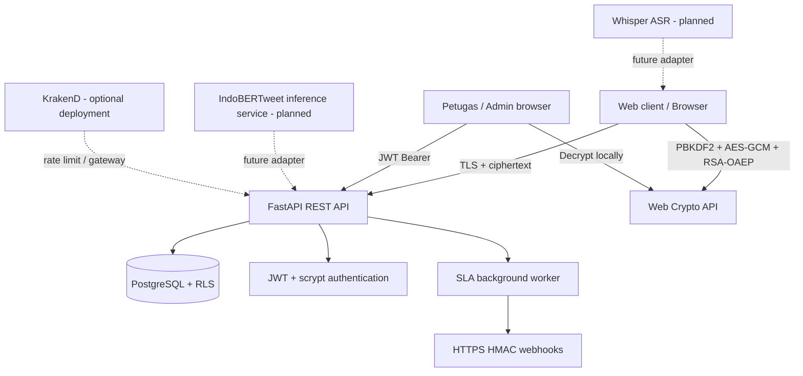
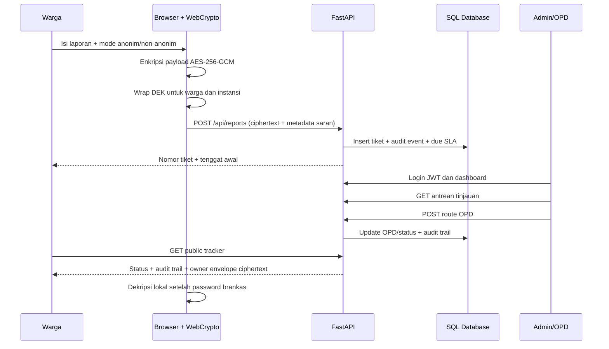

# Arsitektur Implementasi LaporAman

## Komponen

## Siklus kunci dan payload

1. Administrator membuat pasangan RSA-OAEP 3072-bit atau lebih di browser.
2. Browser administrator mengekspor private key ke PKCS#8 dan mengenkripsinya menggunakan AES-GCM dengan wrapping key PBKDF2-HMAC-SHA256 (310.000 iterasi). Server menyimpan public key dan private-key envelope ciphertext.
3. Saat warga mengirim laporan, browser membuat DEK acak 256-bit. Isi laporan dan lampiran dienkripsi menggunakan AES-256-GCM.
4. DEK dibungkus dengan PBKDF2-derived key untuk pemilik dan dengan RSA-OAEP public key instansi untuk petugas.
5. Server menerima payload ciphertext dan envelope, bukan plaintext isi/identitas. Server tidak memiliki private key RSA atau password brankas.
6. Pelapor membuka isi dengan password brankasnya; petugas membuka private key instansi di browser lalu mendekripsi data key dan payload.

**Batas:** metadata operasional tidak terenkripsi sepenuhnya. Tenant, label saran, confidence saran, status, flag anonim, tanggal, tiket, SLA, dan event operasional dapat dibaca backend. Maka istilah E2EE berlaku pada isi laporan/identitas/lampiran, bukan seluruh metadata aplikasi.

## Alur tiket

## Isolasi tenant dan OPD

- JWT diterbitkan backend dan menyertakan subject, tenant, OPD, role, issuer, audience, dan expiry.
- Setiap request petugas divalidasi terhadap akun aktif; tenant/OPD/role token harus cocok dengan data akun saat ini.
- PostgreSQL RLS `ENABLE` dan `FORCE` diterapkan pada reports, report_events, dan webhook_subscriptions. API menetapkan `app.tenant_id`, `app.opd_id`, `app.insert_tenant`, atau `app.public_ticket` melalui `SET LOCAL`.
- SQLite development tidak memiliki RLS; hanya filter otorisasi di API. Tidak untuk penggunaan publik.

## Endpoint inti

| Method | Endpoint | Tujuan | Akses |
|---|---|---|---|
| GET | `/api/health` | Health check | Publik |
| GET | `/api/tenants/{tenant_id}/public-key` | Kunci publik enkripsi tenant | Publik |
| POST | `/api/auth/login` | Login petugas, JWT | Publik + limiter |
| GET | `/api/auth/me` | Profil token | JWT |
| POST | `/api/auth/change-password` | Ganti password dan cabut token lama | JWT |
| POST | `/api/staff/users` | Provision akun operator tenant | Admin |
| GET/PUT | `/api/staff/tenant-key` | Ambil/set key envelope instansi | JWT / admin untuk set |
| POST | `/api/reports` | Submit payload terenkripsi | Publik + limiter |
| GET | `/api/reports/{ticket_id}` | Tracker publik | Ticket ID |
| GET | `/api/staff/reports` | Daftar laporan | JWT + tenant/OPD |
| GET | `/api/staff/reports/{ticket_id}` | Detail ciphertext laporan | JWT + tenant/OPD |
| POST | `/api/staff/reports/{ticket_id}/route` | Verifikasi dan routing manual | Admin |
| PATCH | `/api/staff/reports/{ticket_id}/status` | Transisi status | JWT + tenant/OPD |
| GET | `/api/staff/stats` | Dashboard analytics | JWT + tenant/OPD |
| POST/GET | `/api/staff/webhooks` | Kelola webhook tenant | Admin |

Dokumentasi OpenAPI aktif pada `/openapi.json`, Swagger UI pada `/docs`, dan ReDoc pada `/redoc`.

## Deployment

- Development/test: SQLite.
- Deployment yang disiapkan: Docker Compose, PostgreSQL 16, role runtime `laporaman_app` non-superuser, FastAPI.
- Gateway: KrakenD config contoh, belum berada di Compose default.
- Infrastruktur yang belum menjadi deliverable: Kubernetes, observability cluster, model serving IndoBERTweet, Whisper ASR, mobile native, push notification, konektor SPBE/Smart City, dan formal security/accessibility certification.
